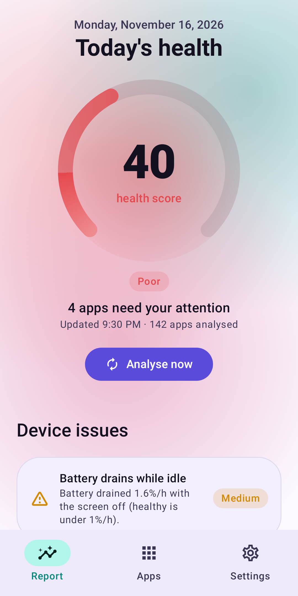
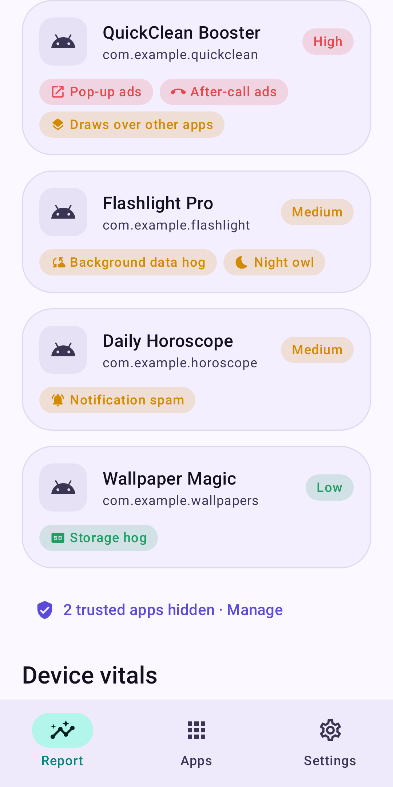
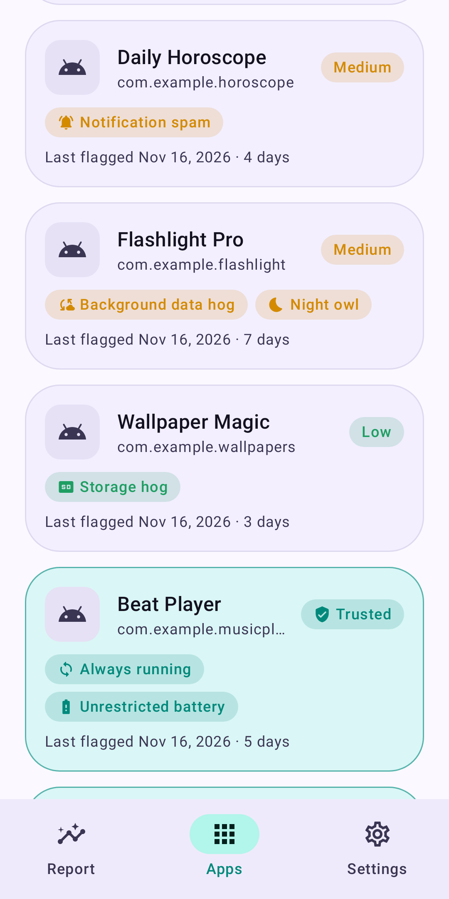
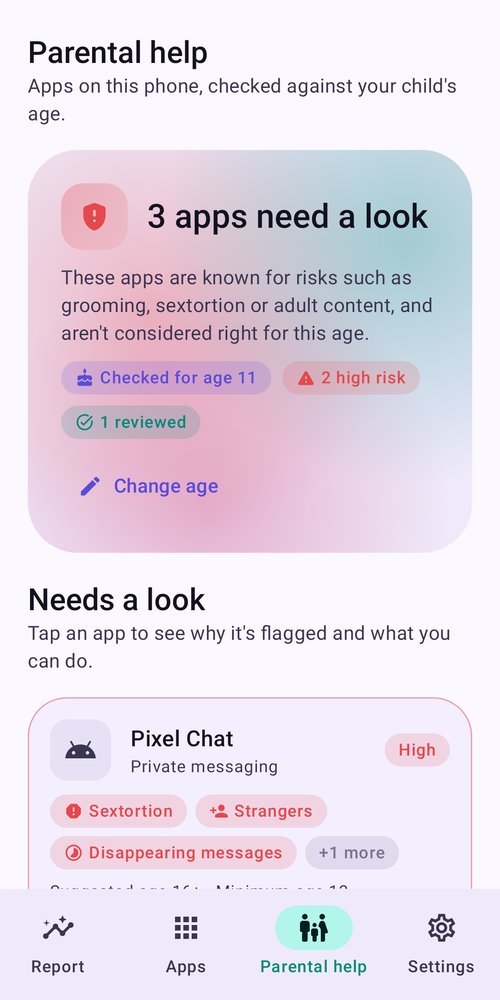
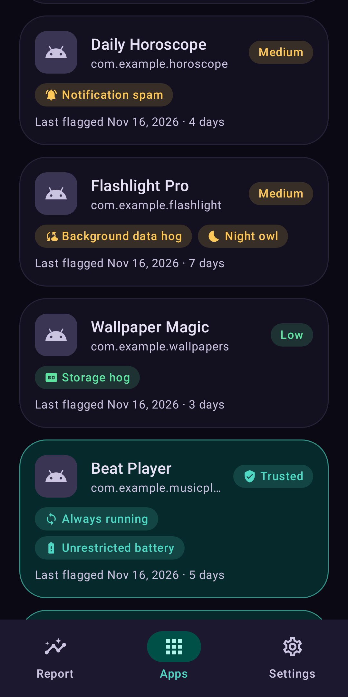
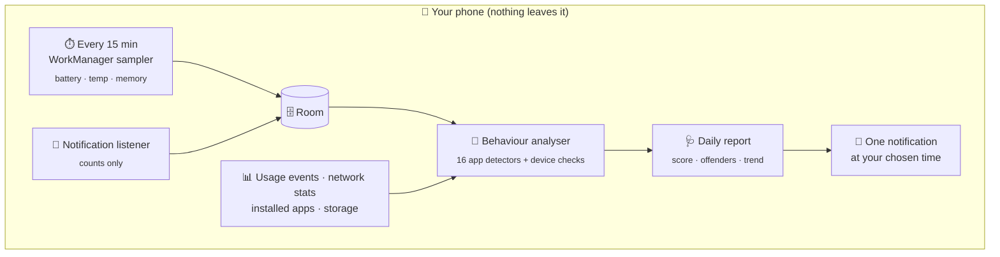
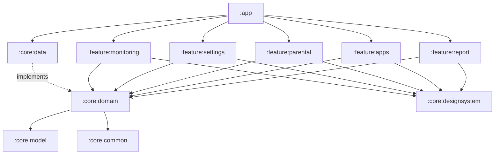

<p align="center">
  
</p>

<p align="center">
  <a href="https://github.com/neteinstein/Perfsentient/actions/workflows/ci.yml"></a>
  <a href="https://github.com/neteinstein/Perfsentient/releases/latest"></a>
  
  
  
  
  
</p>

<p align="center">
  <b>Find the app that's draining your battery, showing pop-up ads or hiding its icon.</b><br>
  Perfsentient watches your phone in the background, works everything out on the device, and gives you<br>
  <b>one plain report a day</b>: a health score, the apps that misbehaved, and the evidence.
</p>

<p align="center">
  <a href="https://github.com/neteinstein/Perfsentient/releases/latest"><b>⬇️ Download the APK</b></a> ·
  <a href="#-what-it-catches">What it catches</a> ·
  <a href="#-setup">Setup</a> ·
  <a href="#-privacy">Privacy</a> ·
  <a href="#-build">Build</a>
</p>

<p align="center">
  <a href="store-listing/video/brag.mp4">
    
  </a><br>
  <sub>20-second launch video, made with <a href="https://github.com/latent-spaces/brag">brag</a>. Click for the full version with sound.</sub>
</p>

---

## 📸 Screenshots

<p align="center">
  
  
  
  
  
</p>

<sub>Rendered from the app's real Compose screens with fictional sample data (not device captures). See
<a href="store-listing/screenshots/README.md">how they are made</a>.</sub>

## ✨ Highlights

- 🩺 **Daily health report.** An animated health score, a one-line verdict, the apps that misbehaved (with the reason for each), device vitals and a 7-day trend.
- 🔔 **One notification a day.** At a time you choose, it tells you whether the day was good or bad and how many apps caused trouble. Tap it to open the report.
- 🚨 **Live security alerts.** Within about 15 minutes of a risky install (a fake app, a remote-access app installed during a call, an app that can read your codes), a high-priority notification names the app and what to do. Each app and behaviour alerts once; trusted apps never do. You can turn alerts off in Settings.
- 🛡️ **Spots scam apps.** Apps installed from a link in a chat, look-alike names ("System Update", a fake bank or WhatsApp), remote-access apps installed during a call, apps that can read your one-time codes, and phone settings that make scams easier (no screen lock, an old security patch, USB debugging left on).
- 🕵️ **Catches ad tricks.** Pop-up ads, ads after a phone call, apps drawing over other apps, and apps that hide their launcher icon.
- 🔋 **Finds battery and data hogs.** Apps that run all day in the background, wake up at night, or use a lot of mobile data you never asked for.
- 📊 **Battery vs time open.** For the last 7 days, which apps used the most battery next to how long you had them open, battery per hour open, and a "Mostly in background" tag for apps that drain it while you're not using them. Tap an app for its day-by-day chart. Android keeps exact per-app battery use private, so this is an estimate.
- ✅ **Trusted apps (whitelist).** If a flagged app is one you rely on (a VPN, a busy chat app), tap **Trust this app** in the report. It's left out of your reports and score from then on.
- 📱 **Apps tab.** Every app flagged now or in the last 30 days in one list. Trusted apps are tinted teal. Tap any app to trust it or stop trusting it.
- 👪 **Parental mode.** Turn it on in Settings, enter your child's age, and a **Parental help** tab appears. It flags installed apps that child-safety groups, regulators and investigations warn about for that age (grooming on Roblox and Discord, sextortion on Snapchat, Instagram and Wizz, random video chat, dating, AI companions, secret vaults…), explains why, and says what you can do. The list and its sources are in [docs/parental-help-research.md](docs/parental-help-research.md).
- 🔒 **Stays on your phone.** The app has no `INTERNET` permission, so it can't send anything anywhere. The release build checks this.
- 🌍 **7 languages.** English, Portuguese, French, Spanish, Italian, Romanian and German, with per-app language selection on Android 13+.
- 🎨 **Modern Android.** Material 3 with dynamic colour, light and dark themes, edge-to-edge, predictive back, and a layout that adapts to tablets and foldables.

## 🔍 What it catches

| | Behaviour | How it's spotted (public, Play-compliant APIs only) |
|---|---|---|
| 📢 | **Pop-up / out-of-context ads** | A short screen from another app appears in the middle of the one you're using (A → X → A), or right after you unlock |
| 📞 | **After-call ads** | A third-party screen appears right after the dialer or in-call screen closes |
| 🪟 | **Overlay abuse** | Has "display over other apps" **and** either hides its icon or is busy in the background while you rarely open it |
| 👻 | **Hidden app** | Installed by you, has no launcher icon, but runs in the background |
| ♾️ | **Always running** | Foreground service for ≥ 2 h a day while you use it for < 15 min (Android vitals wake-lock threshold) |
| 🌙 | **Night owl** | Starts services or screens with the screen off between 00:00 and 06:00 |
| 📶 | **Background data hog** | ≥ 50 MB a day of background mobile data (Android vitals threshold), or ≥ 500 MB over Wi-Fi, from `NetworkStatsManager` |
| 🔕 | **Notification spam** | Notification counts from a `NotificationListenerService`. The content is never read |
| ♿ | **Accessibility / device admin** | Has an accessibility service or device-admin rights turned on. Rated more serious for apps not installed from a store |
| 🔓 | **Unrestricted battery** | Exempt from battery optimisation **and** doing heavy background work |
| 💾 | **Storage hog** | A very large cache (`StorageStatsManager`) |
| 🔗 | **Risky install source** | Not from a store and installed from a chat or email app, or downloaded with access to messages, notifications or the screen (`InstallSourceInfo`) |
| 🔑 | **Can read your codes** | Notification access, SMS permissions or default SMS app. Rated by install source; accessibility + overlay on top is the banking-trojan combination |
| 🖥️ | **Remote access app** | AnyDesk, TeamViewer QuickSupport and similar installed in the last 72 h. High if installed during or just after a phone call |
| 🎭 | **Look-alike app** | Not from a store but named like a system component, a bank or a popular app (case, accents and look-alike characters ignored) |
| 📥 | **Can install apps** | "Install unknown apps" allowed for a sideloaded app, a chat app or a browser |
| 📊 | **Battery vs time open** (an estimate, not a finding) | Each battery drop between two 15-minute samples taken on battery (from the charge counter when the phone reports it) is shared between the apps open on screen and, at a lower weight, the apps running a foreground service at the time. The rest goes to "home screen & system" and "standby" |
| ⏳ | **Not responding / keeps crashing** | Repeated ANRs or crashes in a day, read from the system error log (`DropBoxManager`). Optional: needs `READ_LOGS` (Android 14 and older) or `READ_DROPBOX_DATA` (Android 15+), granted once with `adb shell pm grant <package> <permission>` |
| 🌡️ | **Device issues** | Battery drain with the screen off, temperature, thermal throttling and memory pressure, sampled every 15 minutes |
| 🔐 | **Device security** | No screen lock, a security patch older than 90 days, USB debugging on |

Each finding has a severity, and the severities feed the day's health score. The thresholds are in
[`DetectionThresholds`](core/domain/src/main/kotlin/org/neteinstein/perfsentient/core/domain/analysis/DetectionThresholds.kt).
The scam rules, lists and their sources are in [docs/scam-signals-research.md](docs/scam-signals-research.md).

## ⚙️ How it works



1. A cheap WorkManager job records device vitals every 15 minutes. There's no foreground service. The same job looks at apps installed or updated since the last run, and apps that just got accessibility, notification access or the SMS role, and raises a live alert for the risky ones.
2. At the report time you choose, the analyser reads the last 24 hours of usage events, network stats and stored samples, plus the installed apps, and runs every detector. Each report picks up where the previous one stopped, so the evening after the report time is never missed.
3. The result is saved as the day's report and announced with a single notification.

## 🚀 Setup

1. **Install:** download `Perfsentient_vX.Y.Z.apk` from the [latest release](https://github.com/neteinstein/Perfsentient/releases/latest) and open it on your phone (Android 12L / API 32 or newer). You may need to allow installing apps from your browser or file manager.
2. **Grant access:** open the **Settings** tab. Each permission says *what* it's for and *why*. Tap **Grant** and the button turns into a green tick.

   | Permission | Why |
   |---|---|
   | **Usage access** | Reads app usage events, foreground-service time, background data and cache sizes. It never sees what you do inside apps. |
   | **Notifications** | Lets the app post its one daily report notification. |
   | **Notification access** | Counts notifications per app to spot spam. Titles and messages are never read or stored. |
   | **Installed apps list** | Granted at install. Needed to find hidden icons, overlays, accessibility services and device admins. |

3. **That's it.** Monitoring starts as soon as everything is granted, and your first report arrives that evening. Tap **Analyse now** on the report tab if you want a preview of the day so far.

> [!TIP]
> Usage access and notification access are special permissions that Android only lets you turn on in system settings. The **Grant** button opens the right screen for you.

## 🔒 Privacy

- **No internet.** The manifest *removes* `android.permission.INTERNET`, so no library can add it back. The release workflow fails if it shows up in the merged manifest.
- **No accounts, analytics or ads.**
- **Counts, not content.** Notifications are counted per app. Their text is never read.
- **Your data stays local.** Reports and samples are kept in a local Room database on the phone.

## 🏗️ Architecture

Clean Architecture + MVVM, with one Gradle module per feature. Koin for DI, Coroutines/Flow, Room, DataStore and WorkManager.



| Module | Role |
|---|---|
| `core:domain` | Pure Kotlin: use cases, repository interfaces, the detectors in `analysis/` and the parental catalogue in `parental/` |
| `core:data` | Room, DataStore and the Android system data sources (usage, network, storage, vitals) |
| `core:designsystem` | Aurora theme (light/dark/dynamic), animated gauge, chips and cards |
| `feature:*` | Report tab, Apps tab, Parental help tab, Settings tab, and the background monitoring (workers, scheduler, notification listener) |

Features never depend on each other. See [AGENTS.md](AGENTS.md) for the full module map, conventions and quality gates.

## 🛠️ Build

Requires **JDK 21** and the Android SDK (platform 37).

```bash
./gradlew assembleDebug                          # debug APK
./gradlew assembleRelease                        # R8-minified release APK (signed when a keystore is configured)
./gradlew test testDebugUnitTest                 # unit tests
./gradlew koverVerify :core:domain:koverVerify   # coverage: ≥ 50 % overall, ≥ 90 % domain
./gradlew ktlintCheck :app:lintDebug             # style + Android Lint (zero warnings)
```

| Tech | |
|---|---|
| Language | Kotlin 2.4 (K2), JVM 21 |
| UI | Jetpack Compose, Material 3, `NavigationSuiteScaffold` |
| DI | Koin 4 |
| Storage | Room (KSP), DataStore Preferences |
| Background | WorkManager |
| Build | AGP 9, version catalog, `build-logic` convention plugins, R8 full mode |
| Quality | ktlint, Android Lint, Kover |

## 🚢 CI/CD

- **Every PR:** four parallel jobs: compile (debug + R8 release), unit tests, coverage (with a summary on the job page) and lint.
- **Every merge to `main`:** bumps the patch version, builds the signed APK + AAB, checks there's no `INTERNET` permission, and publishes a [GitHub release](https://github.com/neteinstein/Perfsentient/releases).
- **Google Play:** the upload is set up but switched off for now. Everything for the listing is in [`store-listing/`](store-listing/README.md), the pipeline in [store-listing/publishing.md](store-listing/publishing.md).

## 🏪 Play Store notes

- `PACKAGE_USAGE_STATS` and notification access are special permissions that the user turns on in system settings.
- Listing texts, graphics, Data safety answers and declarations: [`store-listing/`](store-listing/README.md).
- `QUERY_ALL_PACKAGES` needs the *Package visibility* declaration in Play Console. The core purpose is auditing installed apps, like antivirus and security apps do.
